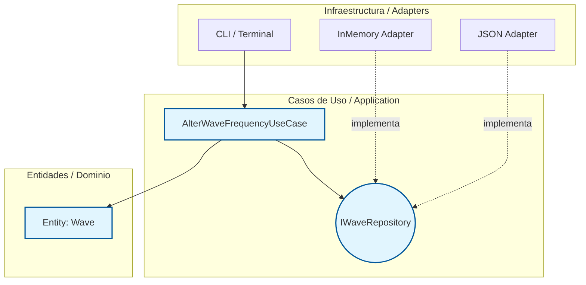

# Music Code
Music Code es un programa para crear y manejar audio usando logica de programación.

Este proyecto ha sido refactorizado siguiendo los principios de la **Arquitectura Limpia (Clean Architecture)** para separar la lógica acústica matemática de las interfaces de usuario y métodos de almacenamiento.

---

## PARTE 1. Identificar el núcleo

A continuación, se describen 3 reglas de negocio fundamentales que componen el núcleo inquebrantable de MusiCode:

### 1. Regla 13: Prohibición de división Acústica
* **Por qué es de negocio:** Protege la integridad matemática de la síntesis de audio (previniendo la división por cero entre señales). No depende de cómo el usuario ingrese el operador `/`, es una ley inquebrantable del motor acústico.
* **Entidad Involucrada:** `Wave`
* **Atributos:** `frecuencia`, `amplitud`

### 2. Regla 18: Multiplicación Escalar como Ganancia
* **Por qué es de negocio:** Dicta el comportamiento físico del sonido; multiplicar una onda por un número plano siempre altera su volumen, nunca su tono o métrica. Es independiente de la interfaz gráfica o la base de datos.
* **Entidades Involucradas:** `Wave`, `Escalar` (numérico)
* **Atributos:** `amplitud`

### 3. Regla 20: Frecuencias siempre Positivas
* **Por qué es de negocio:** En la acústica que simula el lenguaje, no existen frecuencias negativas (menores a 0 Hz). Es una restricción pura del dominio.
* **Entidad Involucrada:** `Wave`
* **Atributos:** `frecuencia`

---

## PARTE 2. Diseño por capas

Para cada regla se definió la siguiente estructura de capas, garantizando la **Regla de Dependencia** (el código exterior depende del interior, nunca al revés).

### Para la Regla 13 (División Acústica):
* **Entity:** `Wave`. *Validación:* El método que combina dos ondas bloquea internamente la operación de división.
* **Use Case:** `OperateWavesUseCase`. *Entrada:* `wave1_id`, `wave2_id`, `operator`. *Salida:* `Wave` resultante. *Pasos:* Obtener ondas del repo, validar operador, aplicar matemática, guardar resultado.
* **Repository Interface:** `IWaveRepository` (con `get(id)` y `save(wave)`).
* **Adapter:** `SymbolTableMemoryAdapter` (guarda las variables temporalmente en la RAM durante la ejecución).

### Para la Regla 18 (Multiplicación Escalar):
* **Entity:** `Wave`. *Validación:* El método `apply_gain(scalar)` verifica que el escalar sea numérico.
* **Use Case:** `ApplyGainUseCase`. *Entrada:* `wave_id`, `scalar_value`. *Salida:* Confirmación de éxito. *Pasos:* Obtener onda, llamar a `apply_gain`, persistir cambios.
* **Repository Interface:** `IWaveRepository`.
* **Adapter:** `SQLiteAudioStateAdapter` (guarda el estado de la onda en una BD local si se está debugeando).

### Para la Regla 20 (Frecuencias Positivas):
* **Entity:** `Wave`. *Validación:* En el setter o método `subFrequency`, si `new_freq < 0`, se lanza un `SemanticError`.
* **Use Case:** `AlterWaveFrequencyUseCase`. *Entrada:* `wave_id`, `hz_to_subtract`. *Salida:* Nueva frecuencia. *Pasos:* Buscar `Wave` vía Interfaz, aplicar resta, manejar excepción si la validación falla, guardar cambios.
* **Repository Interface:** `IWaveRepository`.
* **Adapter:** `JsonProjectAdapter` (guarda el estado de las ondas del proyecto en un archivo `.json`).

### Diagrama de Capas y Dependencias

Ninguna flecha apunta hacia afuera, respetando al 100% la Inversión de Dependencias:

---

## PARTE 5. Cierre

**¿Qué parte de su proyecto les costó más ubicar en una capa?**

La delimitación más compleja fue separar el Manejo de Errores al Usuario (Regla 6). Fue un reto diferenciar que un error de "falta un punto y coma" pertenece a la infraestructura (el parser / CLI), pero un error de "frecuencia negativa" o "división de audios" pertenece a las Entidades del núcleo, ya que corrompe la acústica del lenguaje sin importar cómo se haya escrito. Aunque el fallo ocurra en el negocio, el *formateo de texto y su visualización* es responsabilidad exclusiva de la capa de Interfaz/Presentación.

**¿Qué ganan con poder cambiar la infraestructura sin tocar el núcleo?**

La capacidad de evolucionar el motor de MusiCode de manera aislada y sin romperlo. Al realizar el *Swap de Infraestructura* pudimos intercambiar la forma en que guardamos las ondas (de la memoria RAM a un archivo JSON para persistencia de sesiones) y las reglas de modulación, frecuencias y matemáticas (`Wave`) permanecieron intactas. Al inyectar el repositorio (Swap), el Caso de Uso y la Entidad jamás cambiaron ni una sola línea, demostrando un desacoplamiento total.

---

### Entregable

* **Repositorio del equipo (Rama CleanARC):** [https://github.com/Music-Code-Team/Musicode/tree/CleanARC](https://github.com/Music-Code-Team/Musicode/tree/CleanARC)
* **Tag de Versión de Clean Architecture:** `v1.8.0.0` y su `v1.8.0.0-alpha.1`